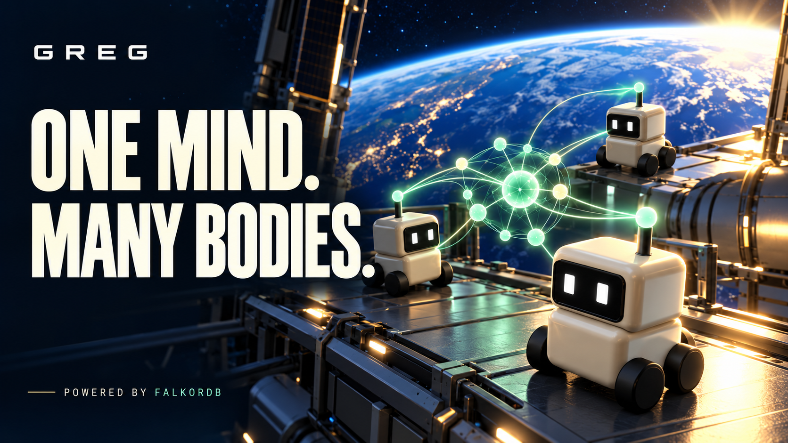
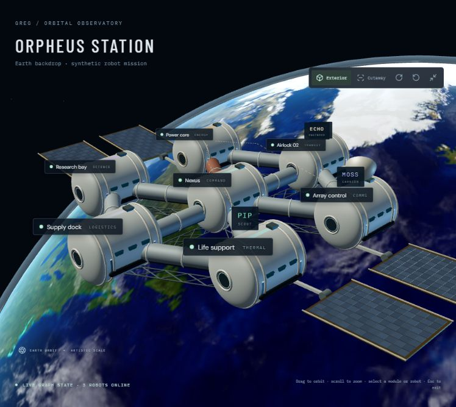
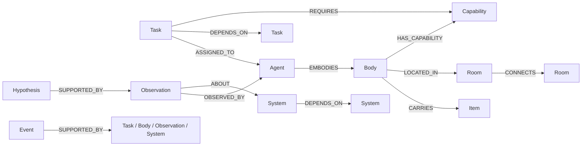
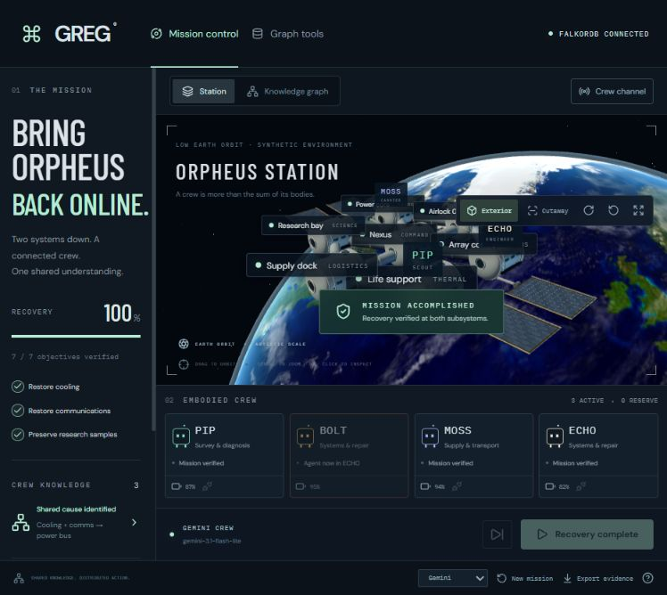

# GREG

Graph Hacks 2026 · **Track 01: Agents That Act on Connected Data**.

**Shared knowledge. Distributed action.** GREG is a prototype robot crew whose
shared world, capabilities, task dependencies, evidence and action receipts live
in FalkorDB. The synthetic orbital station is its stress-test environment.

**[Watch / download the 90-second demo](https://github.com/OptimistOtaku/greg/releases/tag/v0.1.0-demo)** ·
**[Architecture](docs/product.md)** · **[Demo walkthrough](docs/demo.md)**

[](https://github.com/OptimistOtaku/greg/releases/tag/v0.1.0-demo)

The cover is AI-generated promotional art. The demo itself reconstructs an actual
recorded Gemini mission with time compression, shows the changing FalkorDB graph,
and labels its synthetic environment. [Film sources and reproduction](docs/video.md).

The crew inspects cooling and communication failures, correlates a shared power
dependency, delivers a replacement relay, repairs the bus and verifies recovery.
Seal a corridor or disable a robot to watch graph-driven rerouting and an agent
inhabiting the reserve body. The 3D interface includes a live knowledge graph,
executed Cypher inspector and downloadable evidence.



Simulation mode uses a **clearly labeled deterministic controller**. The optional
Gemini function-calling adapter requires a local API key; actual live-model demo
results and interruptions are recorded below. An MCP stdio server exposes the
same bounded crew tools.

## Run mission control

Keep Docker Desktop running. From this checkout, after configuring `.env`:

Prerequisites: Python 3.12–3.13, uv, Node.js/npm, and Docker with Linux containers.
For a fresh checkout, copy `.env.example` to `.env` first; leave `GEMINI_API_KEY`
empty to run simulation. Do not overwrite an existing `.env`.

```powershell
uv sync --locked
docker compose up -d --wait
npm ci --prefix web
npm run build --prefix web
uv run python -m uvicorn greg.main:app --host 127.0.0.1 --port 8000
```

Open **http://127.0.0.1:8000** and click **Activate crew**. Use the robot unplug
buttons to test body outages. **New mission** preserves previous runs. The product
graph is `greg_crew`, separate from the original `greg_setup` smoke-check graph.

For Gemini, add `GEMINI_API_KEY` and optionally `GEMINI_MODEL` to the ignored `.env`,
restart the API, choose Gemini and create a new mission. Missing keys and provider
errors never fall back to simulation. The tested default is `gemini-3.1-flash-lite`;
`GEMINI_MAX_TURNS=60` bounds calls per mission. Provider usage may incur charges.

## Graph model and central queries

Every entity has `run_id`, `id`, and `kind`. All graph reads are scoped to a run.



FalkorDB computes eligible tasks, open corridor paths, common upstream causes,
downstream repair impacts, exclusive task claims and capable replacement bodies.
The actual parameterized queries are in [greg/queries.py](greg/queries.py),
`GET /api/queries`, and the **Graph tools** panel. Removing the database stops
investigation and actions. The browser only displays graph state and interpolates
recorded movement; no alternate in-memory simulator replaces FalkorDB.

See [the architecture, tools and limitations](docs/product.md) and
[the reproducible demo walkthrough](docs/demo.md).

### Orbital 3D view

The Three.js scene places the station above a textured Earth with a cloud layer,
night lighting and an atmospheric limb. Station geometry includes pressure hulls,
connecting tunnels, trusses, solar wings, radiator panels and docking hardware.
Use **Exterior / Cutaway** to reveal the robot crew, drag to orbit, scroll to zoom,
or **Expand 3D scene** for an immersive view. Camera orbit and reset controls are
available. Distances and orbital motion are artistic visualization, not an orbital
mechanics model.

Earth textures are NASA Blue Marble public imagery. Credits and source links:
[web/public/textures/CREDITS.md](web/public/textures/CREDITS.md). They are bundled
locally so the scene does not depend on third-party image servers at runtime.

## Verification and MCP

Run these with FalkorDB and the API running as appropriate:

```powershell
uv run python -m pytest tests -q
uv run python scripts/check_mcp.py
uv run python scripts/evaluate_scenarios.py
```

Tests and the scenario evaluator use isolated randomly named graphs and delete
only those test graphs. No in-memory graph mock substitutes for integration
checks. The scenario report is a deterministic simulation stress test, not a
comparative LLM benchmark.

Launch the MCP stdio adapter with `uv run python -m greg.mcp_server`. It calls the
running local API to preserve a single validated world writer. Tools include
`inspect_context`, `find_route`, `claim_task`, `execute_action`, `inhabit_body`, and
`read_graph_query`. The in-app Gemini loop and external MCP clients both use
actual stdio transport to reach the validated tools through the local API.

## Measured benchmarks

Measured on **18 October 2026**, using real local FalkorDB in Docker, the
deterministic simulation controller and an isolated single-worker API process.
Host: Windows 11, 12 logical CPUs, Python 3.13.5; package versions are recorded
in the report. Latency includes local client/transport overhead.
Raw results: [benchmark-results.json](artifacts/benchmark-results.json).
Methodology, failure records and limits: [docs/benchmarks.md](docs/benchmarks.md).

| Correctness / memory check | Observed result |
| --- | --- |
| Six authored recovery scenarios, ten repeats each | **60/60 completed**, including corridor blockage, three body outages and cargo-carrier failure |
| Evidence-link ablation | **10/10 diagnoses rejected** when observation `ABOUT` links were removed, despite retaining the observation nodes |
| Restored links + fresh client/service/controller | **10/10 completed**, retaining both observations without the original controller's Python state |
| Concurrent task reservation | **20/20 races** produced exactly one successful claimant from two agents |
| Failure-timing sweep | **18/18 completed**: PIP, BOLT and MOSS disabled after 0, 4, 8, 12, 16 or 20 controller steps; each recovered with one body handoff |
| Concurrent HTTP snapshots | **100/100 successful**, eight client threads, **84.14 requests/sec** observed |

Query measurements used **5,251 nodes / 14,048 relationships / 91 missions**.
Each query had ten warmups and 200 timed client-to-database calls.

| Product Cypher query | Median | p95 |
| --- | ---: | ---: |
| Shared upstream cause | 1.190 ms | 1.439 ms |
| Eligible tasks | 1.495 ms | 1.874 ms |
| Dependency impact | 1.315 ms | 2.109 ms |
| Capable replacement body | 1.273 ms | 1.857 ms |
| Open corridor route | 12.776 ms | 16.776 ms |

Real loopback HTTP snapshot reads measured **13.991 ms median / 16.897 ms p95**;
agent-context reads measured **24.055 ms / 33.550 ms** (100 sequential requests
each, after five warmups). Under eight-client snapshot contention, p95 was
**143.575 ms**. These are local observations, not maximum production capacity.

MCP `inspect_context` measured **447.924 ms median / 491.944 ms p95** over a
persistent stdio session (20 calls). The current production bridge starts a fresh
MCP process per call: **2,294.862 ms median**, including startup and teardown
(only three calls). Process startup and per-call HTTP-client setup are transport
overheads to optimize; these figures exclude any Gemini inference time.

The timing sweep's individual results are in
[fault-timing-results.json](artifacts/fault-timing-results.json). Reproduce with
FalkorDB running; both scripts use disposable graphs and leave demo missions
untouched. The primary benchmark starts its own isolated API:

```powershell
uv run python scripts/benchmark.py
uv run python scripts/benchmark_fault_timing.py
```

These are **authored deterministic simulation and infrastructure benchmarks**.
Repeated scenarios are not independent unseen tasks or a real-world reliability
estimate. The ablation proves this implementation needs graph relationships;
it does not claim superiority over SQL, vector memory or other agent systems.
Fresh-client recovery does not establish database restart/crash durability.

## Live Gemini demo results

Three real-model demo missions completed on **18 October 2026**, through
Gemini → MCP stdio → HTTP action validation → FalkorDB. No deterministic fallback
was used. Every mission completed **7/7 objectives with two verification edges**.



| Scenario | Model turns | Tool results | Rejected tool requests | Body handoffs |
| --- | ---: | ---: | ---: | ---: |
| Normal recovery, resumed after provider interruption | 31 | 27 | 0 | 0 |
| Hub/power corridor sealed | 33 | 33 | 1 | 0 |
| BOLT fails after the first inspection | 35 | 35 | 4 | 1 |

The nominal mission used `gemini-3.5-flash` for 18 tool results, then resumed with
`gemini-3.1-flash-lite` for nine more after a provider quota interruption and API
restart. Shared graph evidence and completed work survived fresh agent histories.
The two fault scenarios used `gemini-3.1-flash-lite` throughout. The engineering
agent inherited ECHO at its actual airlock location and completed the outage run.

Earlier 3.8 Flash attempts hit a now-fixed conversation-format bug and provider
high demand. The 3.5 Flash tier subsequently reached its observed 20-request
daily free-tier cap. These attempts are retained, not counted as completed trials.
The report records model changes and interruptions. Model turns can include
failed requests; SDK retries are not separate rows. Rejected model requests were
blocked by validators and corrected on later turns.

These are **three authored demonstrations**, not a statistical reliability or
single-model superiority claim. Provider availability and account quotas vary.

- [Full live evaluation](artifacts/gemini-evaluation.json)
- [Normal recovery evidence](artifacts/gemini-nominal-replay.json)
- [Blocked-corridor evidence](artifacts/gemini-blocked-corridor-replay.json)
- [Body-outage evidence](artifacts/gemini-mid-mission-body-outage-replay.json)
- [Run/resume instructions and interruption history](docs/live-gemini.md)

```powershell
uv run python scripts/evaluate_gemini.py
# Continue saved missions after a provider interruption:
uv run python scripts/evaluate_gemini.py --resume
```

## Data and demo

All topology, robot designs, mission descriptions and fault data are original
synthetic content. No private/restricted data or external models/assets are loaded
into the graph. Geometry is generated in code; dependencies and bundled fonts
retain upstream licenses. This prototype does not establish research novelty,
real-world robotics reliability, or model-training improvements.

This source repository is public. The recorded demo, captions, and thumbnail are
available in the [demo release](https://github.com/OptimistOtaku/greg/releases/tag/v0.1.0-demo).
Complete local setup is provided; no public live backend is claimed.
See [data and asset provenance](docs/data-provenance.md) for source details.

## Initial environment setup

Prerequisites: Python 3.12 or 3.13, [uv](https://docs.astral.sh/uv/), Docker Desktop using Linux containers, and Node.js/npm for the React/Three.js frontend.

Run from this repository in PowerShell:

```powershell
Copy-Item .env.example .env
uv sync --locked
docker compose up -d --wait
uv run python scripts/check_graph.py
```

Do not overwrite an existing `.env`; edit it instead. Local database: `127.0.0.1:6379`. [FalkorDB Browser](http://localhost:3001) uses port 3001 to leave 3000 free for the application.

The smoke check writes three isolated `SetupCheck` nodes using MERGE and verifies a two-hop traversal in the real database. It is idempotent and does not delete graphs. It validates the initial database foundation; product behavior is covered by the integration tests above.

```powershell
docker compose config --quiet
docker compose ps
docker compose logs --tail 50 falkordb
docker compose stop
```

The named volume preserves database files across normal container recreation. Do not remove that volume if you want to retain data. The image is pinned by digest in Compose and `.env.example`. The verified data directory is `/var/lib/falkordb/data`; confirm with `docker compose exec -T falkordb redis-cli CONFIG GET dir` when changing images.

For Cloud, set the host, port, credentials and TLS setting in `.env`, and run only the Python check. Compose is intended for local unauthenticated use and binds ports only to localhost; `.env` Cloud credentials are consumed by Python, not by the local container.

Official brief: [Graph Hacks](https://www.wemakedevs.org/hackathons/falkordb). Rules: [submission requirements](https://www.wemakedevs.org/hackathons/falkordb/rules).
