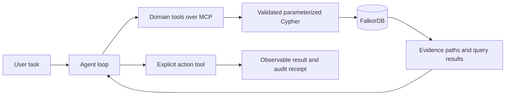

# Track 1 preparation

Historical preparation notes. The implemented product is now the orbital robot
crew described in README.md and docs/product.md; brainstorming items below
record the original preparation rather than current implementation status.

## What we need to build

A working agent whose graph queries change its decisions and cause a visible action. Every decisive claim should point to actual returned relationships. FalkorDB must be indispensable to that flow.

Product selection is deferred until brainstorming with the participant. No domain application, LLM provider, deployment service or frontend framework has been selected or installed.

## Strong submission criteria

These are our planning criteria, not an official weighted judging rubric:

| Criterion | Question for each idea |
| --- | --- |
| Graph necessity | What meaningful multi-hop question fails when we remove the graph? |
| Real agency | Which tools does the model choose, and how does evidence change that choice? |
| Concrete action | What state changes, and how can the demo prove its effect? |
| Explainability | Can the viewer inspect the exact path and source facts behind a decision? |
| Distinctiveness | What is different from the organizer's example and obvious chatbot demos? |
| Reliability | Can we handle missing evidence, unknown entities and misleading connections? |
| Feasibility | Can we complete a compelling end-to-end slice solo before the deadline? |

The organizer already supplies a service-dependency incident agent called **Blast Radius** in its tutorial. A similar ops/code/security concept will need a clear original contribution. Fraud is also explicitly listed as an example; choosing that domain alone does not establish originality.

## Reusable architecture for brainstorming

Use domain-specific tools with typed arguments, bounded graph traversal and read-only queries for investigation. Keep state-changing tools separate. Decide on action permissions according to the selected product. Do not give a model unrestricted graph deletion or arbitrary shell execution simply to demonstrate tool use.

Start with one agent. Multi-agent coordination is not necessary for Track 1 and adds scope unless the chosen problem benefits from it. Use an algorithm only when it helps answer the real question; algorithm count is not a published scoring criterion.

## Suggested build order after idea selection

1. Define one user, one painful task, one decisive multi-hop path and one observable action.
2. Specify node/edge semantics and create permitted, reproducible data with known expected outcomes.
3. Verify decisive Cypher queries against real FalkorDB before adding the LLM.
4. Implement MCP tools and action semantics; show that altered graph evidence changes behavior.
5. Connect a real tool-calling agent; keep any deterministic replay clearly labeled.
6. Add the smallest clear interface that exposes task, evidence, action and result.
7. Verify failure cases, restart persistence, repeatability and fresh-checkout setup.
8. Deploy if feasible; prepare video, graph model, query documentation and AI disclosure.

Aim to freeze the core product on October 18 by 4 PM IST, finish the submission package by 8 PM, and target submission by 10 PM. These are internal buffers; the official deadline is 11:59 PM IST. Prioritize a complete, explainable vertical slice over extra features.

## Acceptance gates to adapt to the chosen idea

- Real FalkorDB queries execute in the live application.
- At least one useful multi-hop question and one action are demonstrated end to end.
- Model-selected tools and their inputs/results are visible in a trace.
- Removing or changing decisive graph evidence changes the decision.
- Unknown entities and insufficient evidence do not produce invented certainty.
- Benign/negative examples challenge the central claim, not just the happy path.
- Repeating an action does not accidentally duplicate its effect where idempotence is expected.
- Database outages are reported; cached or fixture answers are never presented as live evidence.
- A fresh checkout can reproduce the demo using the README.

## Items still needed before product implementation

- Brainstorm and choose the problem with the participant.
- Confirm registration and submission portal fields.
- Select an available LLM provider and supply a credential through local environment settings.
- Select a hosting approach once the product's requirements are clear.

Sources: [Track brief](https://www.wemakedevs.org/hackathons/falkordb), [rules](https://www.wemakedevs.org/hackathons/falkordb/rules), [organizer tutorial](https://www.wemakedevs.org/blogs/how-to-build-an-agent-that-reasons-over-a-graph), [official MCP server](https://github.com/FalkorDB/FalkorDB-MCPServer).
